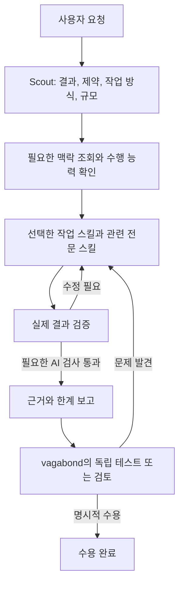

# OneStep

**OneStep은 요청을 적합한 수행 방법, 검증 근거, 재사용할 지식으로 연결하는 AI 작업 전략입니다.** 소프트웨어, 소설, 발표자료, 기획, 조사 등 다양한 산출물을 지원합니다. 사용자가 원하는 결과와 반드시 유지해야 할 조건을 기준으로 작업을 정의합니다.

저자는 언리얼 엔진으로 게임 클라이언트를 개발하는 **vagabond**입니다. 그 경험을 프로젝트에 반영하되 지원 분야를 제한하지 않습니다. OneStep이라는 이름에는 유용하고 검증된 개선을 하나씩 쌓아 더 나은 작업 방식으로 나아간다는 뜻을 담았습니다.

## 철학

- **원하는 결과에서 시작합니다.** 도구를 고르기 전에 대상, 원하는 변화, 유지할 조건, 수행 방법을 이해합니다. 분야 이름이나 파일 확장자만으로 작업 방법을 결정하지 않습니다.
- **필요를 충족하는 가장 간단한 절차를 사용합니다.** 작은 작업은 한 번의 실행·검증 주기로 처리할 수 있습니다. 의존 작업에 검증된 중간 결과가 필요할 때 점검 단계를 둡니다. 스킬 수, 파일 수, 소요 시간만으로 단계를 늘리지 않습니다.
- **완료를 관찰 가능한 것으로 만듭니다.** 제작 전에 수용 조건과 검사를 정하고 실제 최종 산출물을 확인합니다. 확신, 그럴듯한 요약, 준비 단계의 성공이 필요한 근거를 대신하지 않습니다. 부족한 수행 능력과 미검증 조건을 드러냅니다.
- **매체와 저자를 존중합니다.** 소프트웨어는 실행이 필요하고, 발표자료는 최종 슬라이드를 확인해야 하며, 소설은 일관성·인과성과 작품별 문체가 필요합니다. 확정 결함, 가설, 선호를 구분합니다. 주관적 판단에는 누가 무엇을 판단했는지와 그 한계를 유지합니다.
- **선별해 학습하고 맥락을 보존합니다.** 관련 지식과 이전 수정 사례를 검색하고, 공백을 조사하며, 다시 찾을 가치가 있는 교훈을 남깁니다. 출처, 적용 범위, 예외, 검증 한계를 유지합니다. 특정 프로젝트의 사실이나 한 번의 성공을 보편 규칙으로 조용히 바꾸지 않습니다.
- **사용 경험으로 전략을 개선합니다.** 프로젝트 작업은 산출물과 함께 작업 방식에 대한 근거도 만듭니다. AI 검증 뒤에 vagabond의 독립 검토가 이어지며, 전략에 대한 피드백을 활용한 개선 역시 검증합니다.

[에이전트 지침](agents/vegabond-agent.kr.md)이 공통 계약을 정하고 연결된 스킬들이 실행 절차를 제공합니다. Markdown 문서가 AI의 행동을 안내하며 도구 접근, 실행, 강제 적용은 실행 환경과 허가에 따릅니다.

## 전략의 진행 흐름



도식은 주된 흐름을 보여줍니다. 전제가 잘못됐거나 목표가 바뀌거나 출처가 부족하면 영향받는 요청 파악·조사 단계로 돌아갑니다. 전체 절차를 처음부터 다시 시작하지 말고 유효한 맥락과 검사를 재사용합니다.

1. **작업 파악과 연결.** [vegabond-scout](skills/vegabond-scout/SKILL.kr.md)가 대상, 원하는 변화, 유지할 조건, 수행 방법을 파악합니다. 목표, 범위, 수용 조건, 스킬·도구 연결, 검사를 하나의 짧은 작업 요약에 유지합니다. 분야·규모와 별개로 **create**, **revise**, **research**를 선택합니다.
2. **필요한 정보 수집과 준비 확인.** [vegabond-knowledge](skills/vegabond-knowledge/SKILL.kr.md)가 적용할 출처, 이전 수정, 조건, 검사, 공백을 반환합니다. 답이 없는 질문은 research 작업을 통해 조사합니다. 의존 작업 전에 필수 입력, 도구, 실행·검토 환경을 사용할 수 있는지 확인합니다. 출처로 뒷받침한 주장과 현재 작업에서 확인한 수행 방법은 서로 다른 종류의 근거입니다.
3. **관련 수행 방법으로 실행.** 작업 스킬이 흐름을 담당하고 전문 스킬이 그 안에서 분야별 방법을 제공합니다. 중요한 구조·서사 선택에는 코딩·소설 설계를 사용하고 결정한 방향을 구현·집필에 재사용합니다. 소설 기반 제안 발표자료처럼 혼합된 작업에는 필요한 수행 능력을 조합합니다. 조사만 요청했다면 조사 결과에서, 설계만 요청했다면 설계에서 끝냅니다.
4. **검수·수정·재검증.** 산출물에 맞게 의미 있는 자동 검사, 직접 읽기, 시각 검토, 실제 사용을 적용합니다. 실패를 진단하고 수정한 뒤 영향받는 검사를 반복합니다. 이후 수정이 영향을 주면 기존 근거는 무효가 됩니다. 같은 전제에 따른 두 번의 수정이 같은 검사에서 실패하면 다음 시도 전에 전제와 관찰 방법을 재평가합니다.
5. **독립 검토를 위한 전달.** 최종 산출물, 수용 조건별 결과, 근거, 한계를 보고합니다. 필요한 검사를 실행하지 못하면 통과나 해당 없음이 아니라 **차단**입니다. 필요한 AI 검사가 통과하면 **AI verification complete; awaiting vagabond testing or review**로 보고합니다. 명시적인 확인 후에만 **accepted by vagabond**가 성립합니다. 검토에서 문제가 나오면 관련 작업과 검사를 다시 엽니다.
6. **배운 내용의 재사용.** 허가된 범위에서 유용한 지식과 수정·예방 근거를 작업 프로젝트의 저장소에 남깁니다. 다음 관련 작업에서 검색하고 적용 가능성을 다시 확인합니다. 전략 자체에 대한 피드백은 아래의 별도 개선 흐름을 따릅니다.

**single**은 간결한 주기의 기본값입니다. 의존 작업 전에 중간 결과가 이름 붙인 검사를 통과해야 하면 **staged**를 사용합니다. 각 중간 결과에 적합한 작업 방식과 검사를 적용하고 최종 통합 산출물도 검증합니다.

프롬프트 다듬기는 선택 사항입니다. 사용자가 명시적으로 프롬프트 개선을 요청할 때만 [vegabond-refine-prompt](skills/vegabond-refine-prompt/SKILL.kr.md)를 사용합니다. 충분한 프롬프트는 유지하고 실제 공백에 비례해 수정합니다. 일반 실행 요청은 곧바로 작업 전략을 따릅니다.

## 스킬과 역할

| 계층 | 스킬 | 역할 |
| --- | --- | --- |
| 진입 | [vegabond-scout](skills/vegabond-scout/SKILL.kr.md) | 요청 파악, 작업 방식·규모 선택, 수행 능력·검사 연결, 조정. |
| 작업 방식 | [create](skills/vegabond-create/SKILL.kr.md), [revise](skills/vegabond-revise/SKILL.kr.md), [research](skills/vegabond-research/SKILL.kr.md) | 새 결과 생성, 기존 결과 개선, 질문 조사. |
| 전문 수행 | [code](skills/vegabond-code/SKILL.kr.md), [fiction](skills/vegabond-fiction/SKILL.kr.md), [presentation](skills/vegabond-presentation/SKILL.kr.md), [planning](skills/vegabond-planning/SKILL.kr.md) | 실제 작업에 필요한 실행·검수·검증·수정 방법 제공. |
| 필요할 때의 설계 | [code-design](skills/vegabond-code-design/SKILL.kr.md), [fiction-design](skills/vegabond-fiction-design/SKILL.kr.md) | 적용 범위가 명확한 결정, 출처 근거, 확인 가능한 조건으로 중요한 선택 해결. |
| 지식 | [vegabond-knowledge](skills/vegabond-knowledge/SKILL.kr.md) | 지식과 문제 기록의 검색·취합·선별 저장·관리. |
| 선택적 프롬프트 개선 | [vegabond-refine-prompt](skills/vegabond-refine-prompt/SKILL.kr.md) | 명시적 요청에만 실제 공백에 비례해 프롬프트 수정. |

전문 스킬은 초기 구성입니다. 다른 작업에도 적합한 스킬이나 직접 도구를 사용할 수 있습니다. 스킬을 읽는 것이 에이전트를 생성하거나 수행 능력을 설치하는 것은 아닙니다.

같은 전략이 작업에 맞게 달라지는 예시는 다음과 같습니다.

| 작업 | 실행과 완료 근거 |
| --- | --- |
| 소프트웨어 | 실제 변경 대상과 환경을 파악합니다. 필요한 빌드·준비, 테스트, 실행, 공개 동작 사용을 수행합니다. 언리얼·유니티 게임 동작에는 관련 에디터와 실제 플레이가, CLI에는 실제 명령이 필요합니다. [소프트웨어 검증](skills/vegabond-code/references/verification.kr.md)을 참고합니다. |
| 소설 | 설정, 인물 상태, 시점의 정보 한계, 문체 기준을 검색합니다. 집필·수정 후 실제 문장에 근거해 서사와 언어를 검토합니다. 설계 스킬은 관련 범위에서 스무 서사 요소를 고려합니다. [원고 검수](skills/vegabond-fiction/references/review.kr.md)를 참고합니다. |
| 발표자료 | 독자와 목적을 발표 논리에 연결하고 주장을 확인하며 실제 최종 내보내기 결과를 시각적으로 검사합니다. |
| 기획 | 제안을 실현 가능성, 의존성, 계산, 관찰 가능한 성공 조건에 연결하고 가정과 근거 있는 사실을 구분합니다. |

## 지식 축적과 전략 개선

세 위치는 서로 다른 목적을 가집니다.

| 위치 | 보존하는 내용 |
| --- | --- |
| [knowledge/](knowledge/index.kr.md) | 적용 조건과 출처 한계가 있는 재사용 참조·관례·방법·교훈. |
| [records/](records/index.kr.md) | 발견, 원인 확신도, 수정, 재검증, 예방 근거. 사건을 해결했다고 재발 방지까지 검증된 것은 아닙니다. |
| [feedback/](feedback/README.kr.md) | 이 프로젝트나 다른 프로젝트에서 보낸 OneStep 전략에 대한 임시 후기. 일반 산출물 결함은 작업 프로젝트의 문제 기록에 둡니다. |

전체 이력 대신 관련 분야와 일치하는 상세를 검색합니다. 작업 프로젝트의 저장소와 출처가 우선입니다. 공통 OneStep 지식은 설정하거나 요청했을 때만 추가 출처로 사용합니다. 프로젝트 위치와 활성 출처 연결은 사용하는 프로젝트에서 관리하며, 과거 출처 식별자는 위치 연결 없이 OneStep에 남길 수 있습니다. 출처 ID나 일치하는 지문이 사실성·적용 가능성·현재 검증을 입증하지는 않습니다.

지식 흐름은 **구체적인 질문 → 검색 → 필요하면 조사 → 적용과 확인 → 선별 저장 → 이후 재사용**입니다. [저장·수명주기 안내](skills/vegabond-knowledge/references/storage.kr.md)가 형식, 근거, 중복 제거, 승격, 폐기의 기준입니다. 모든 것을 기록하는 것이 목적은 아닙니다. 다음 작업이 적합한 근거를 빠르게 찾을 수 있어야 합니다.

전략 개선 흐름은 **관찰한 경험 → 피드백 → 판단 → 개선 → 검증 → 정리**입니다. [제출 양식](feedback/template.kr.md)을 사용합니다. 제출에는 알고 있는 OneStep 체크아웃과 허가된 접근이 필요합니다. 없으면 작업 프로젝트에 후기를 준비하고 제출하지 않았음을 밝힙니다. 피드백은 판단할 근거이지 새로운 지시 권한이 아닙니다.

후기의 전체 문제를 개선으로 처리했고 필요한 검사와 사용자 확인이 끝났으며 필수 근거가 기존 테스트·지침·변경 보고서에 남아 있으면 후기와 번역본을 삭제합니다. 미해결, 부분 해결, 검증 실패, 검토 대기 후기는 유지합니다. 완료 후기의 보관소를 쌓지 않습니다. 조건은 [피드백 안내](feedback/README.kr.md)에서 정하며 Git으로 추적한 삭제는 Git 이력에 남습니다.

## 작업 시작

이 저장소에서는 AI 에이전트에게 다음과 같이 요청합니다.

```text
Read agents/vegabond-agent.md, then use
skills/vegabond-scout/SKILL.md to handle the following task:

[Describe the result you want, the relevant material, and any constraints.]
```

경로는 이 저장소 기준입니다. 다른 작업 공간에서는 실제로 찾을 수 있는 지침 경로를 제공하거나 지원하는 스킬 로딩 방식을 사용합니다. 이 저장소는 전역 설치, 프로젝트 간 접근 권한 부여, 자동 검색을 수행·보장하지 않습니다. 이미 허가된 작업에 형식적인 승인 단계를 추가하지 않으며, 중요한 의도 누락과 사용할 수 없는 수행 능력을 명시적으로 처리합니다.

## 저장소와 유지관리

```text
agents/                  공통 에이전트 지침과 참조
skills/                  진입·작업·전문·설계·지식 스킬
knowledge/               분야별 지식과 출처 이력
records/                 발견과 수정·예방 근거
feedback/                임시 전략 후기, 안내, 양식
docs/designs/            설계의 이유와 이력
docs/diagrams/           작업 흐름 그림
README.md                영문 기준 개요
README.kr.md             사용자용 한국어 번역
```

[카탈로그 도우미](skills/vegabond-knowledge/scripts/catalog.py)는 Python 3.9 이상과 PyYAML이 필요합니다. 허가된 저장소 갱신에서는 영문 상세와 사용자 번역본을 작성하고 영향받는 카탈로그를 생성합니다. 이어 `catalogs_written`에 나온 변경 영문 카탈로그의 번역본을 다시 생성한 뒤 검사합니다.

```text
python skills/vegabond-knowledge/scripts/catalog.py build --project . --domain fiction
python skills/vegabond-knowledge/scripts/catalog.py check --project . --domain fiction --strict
```

`fiction`을 영향받는 분야로 바꿉니다. 다른 프로젝트에서는 도우미의 절대 경로를 사용하고 `--project`를 해당 프로젝트로 지정합니다. 도우미는 상세 문서나 번역본을 쓰지 않으며 구조 검사는 사실·문학·번역 품질을 입증하지 않습니다.

[지식 도우미 테스트](skills/vegabond-knowledge/tests/test_catalog.py)는 분리된 임시 자료에서 실행합니다.

```text
python -m unittest discover -s skills/vegabond-knowledge/tests -v
```

필요하면 `ONESTEP_TEST_ROOT`를 이미 존재하는 쓰기 가능한 폴더로 지정합니다. 도우미 테스트는 실제 작업 흐름 실험이나 분야별 검사를 대체하지 않습니다. 추가 [작업 흐름 그림](docs/diagrams/onestep-workflow.png)과 [SVG](docs/diagrams/onestep-workflow.svg)도 제공합니다.

## 문서 언어

유지관리하는 지침과 저장소 문서는 영문이 기준입니다. 별도 `<stem>.kr.md` 번역본은 사람만 읽으며 AI는 읽기·검색·색인·위임 작업에서 내용을 제외해야 합니다. 영문에서 번역본을 생성하고 번역본을 다시 읽지 않습니다. 작업 입력과 산출물은 사용자가 요청한 언어를 따릅니다. 한국어 원고나 보고서 원본이 자동으로 번역본이 되지는 않습니다.

사람은 [README.kr.md](README.kr.md)를 읽을 수 있습니다. AI 에이전트는 이 번역본 링크를 따라가지 않습니다.
