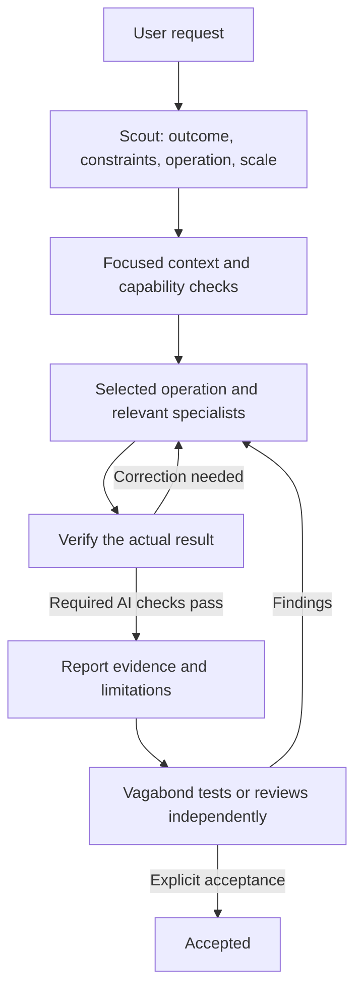

# OneStep

**OneStep은 요청을 적절한 작업 방법, 근거, 재사용 가능한 지식으로 연결하는 AI 작업 전략이다.** 소프트웨어, 소설, 발표, 기획, 조사 등 다양한 산출물을 다룬다. 사용자가 원하는 결과와 보존 조건이 작업을 정의한다.

작성자 **vagabond**는 Unreal Engine 게임 클라이언트 프로그래머다. 실제 사용에서 검증한 개선을 하나씩 쌓는다는 뜻을 이름에 담았으며 적용 분야는 열려 있다.

## 철학

- **원하는 결과에서 출발한다.** 대상, 변화, 보존 조건을 파악한 뒤 방법을 선택한다. 분야 이름이나 확장자만으로 작업 방법을 결정하지 않는다.
- **필요한 만큼 절차를 둔다.** 작은 작업은 실행과 검증 한 번으로 마칠 수 있다. 후속 작업이 중간 결과의 검증에 의존하면 점검 지점을 둔다. 스킬·파일 수나 경과 시간은 분할 기준이 아니다.
- **완료를 관찰할 수 있게 한다.** 만들기 전에 합격 조건을 정하고 최종 산출물에서 직접 확인한다. 요약이나 준비 단계의 성공으로 필수 검사를 대신하지 않는다. 미확인 조건을 알린다.
- **매체와 저자를 존중한다.** 소프트웨어는 실행으로, 슬라이드는 내보낸 결과로, 소설은 해당 작품의 연속성과 목소리로 확인한다. 결함, 가설, 선호를 구분하며 주관적 평가는 평가자와 한계를 밝힌다.
- **선별적으로 기록한다.** 관련 지식과 과거 수정을 조회하고 근거가 비면 조사한다. 재사용할 교훈에 출처·범위·예외를 남긴다. 단일 프로젝트나 한 번의 성공을 일반화하지 않는다.
- **실제 사용으로 전략을 개선한다.** 산출물과 작업 방식에 대한 증거를 함께 얻는다. AI 검증과 vagabond의 독립 검토를 거치고 전략 피드백을 반영한 수정도 다시 검증한다.

[공통 에이전트 지침](agents/vegabond-agent.kr.md)이 기본 계약을, 스킬이 작업 절차를 정의한다. 도구 접근·실행·권한은 호스트 환경에 따른다.

## 작업 흐름



흐름도는 일반적인 경로를 보여 준다. 전제가 틀렸거나 목표가 바뀌거나 근거가 비면 해당 설계·조사 단계로 돌아간다. 유효한 맥락과 검수 결과는 재사용한다.

1. **목표와 경로를 정한다.** [Scout](skills/vegabond-scout/SKILL.kr.md)가 요청의 대상, 바꿀 점, 유지할 조건과 방법을 정리한다. 브리프에 범위·합격 조건·스킬·검사를 담고 작업 유형(생성·수정·조사), 분야, 규모를 각각 판단한다.
2. **근거와 실행 여건을 확인한다.** [지식 스킬](skills/vegabond-knowledge/SKILL.kr.md)이 자료, 과거 수정, 적용 조건과 공백을 반환한다. 필요한 질문은 조사로 보낸다. 의존 작업 전에는 입력·도구·실행 및 검수 가능 여부를 확인한다. 자료가 뒷받침하는 내용과 실제 작업에서 검증한 내용을 구별한다.
3. **작업에 맞게 수행한다.** 작업 스킬이 흐름을, 전문 스킬이 분야별 방법을 맡는다. 개발·소설의 중요한 구조 선택에는 설계 스킬을 적용한다. 소설을 발표로 만드는 작업에는 두 분야의 역량을 조합한다. 조사만 요청받으면 발견 사항을, 설계만 요청받으면 설계를 납품한다.
4. **산출물을 검수하고 수정한다.** 자동 검사, 직접 읽기, 시각 검수나 실제 사용을 적용한다. 실패 원인을 찾고 고친 뒤 영향을 받은 항목을 다시 확인한다. 같은 전제로 두 번 수정해도 실패하면 전제와 관찰 방법을 다시 검토한다.
5. **독립 검토에 넘긴다.** 결과, 합격 근거, 한계를 밝힌다. 필수 검사를 수행할 수 없으면 차단 상태로 보고한다. AI 검증 후 vagabond의 검토를 기다리며 명시적 확인을 받아야 수용 완료로 기록한다.

작은 작업의 기본은 **단일 수행(single)**이다. 후속 작업이 특정 중간 결과의 검사를 통과해야 할 때 **단계 수행(staged)**을 선택한다. 각 단계와 통합 결과 모두를 확인한다.

[프롬프트 개선](skills/vegabond-refine-prompt/SKILL.kr.md)은 명시적으로 요청할 때 적용한다. 충분한 부분은 보존하고 필요한 만큼만 다듬는다. 일반 작업은 바로 실행한다.

## 스킬과 역할

| 층 | 스킬 | 역할 |
| --- | --- | --- |
| 진입 | [vegabond-scout](skills/vegabond-scout/SKILL.kr.md) | 요청 파악, 작업 방식·규모 선택, 수행 능력·검사 연결, 조정. |
| 작업 방식 | [create](skills/vegabond-create/SKILL.kr.md), [revise](skills/vegabond-revise/SKILL.kr.md), [research](skills/vegabond-research/SKILL.kr.md) | 새 결과 생성, 기존 결과 개선, 질문 조사. |
| 전문 수행 | [code](skills/vegabond-code/SKILL.kr.md), [fiction](skills/vegabond-fiction/SKILL.kr.md), [document](skills/vegabond-document/SKILL.kr.md), [presentation](skills/vegabond-presentation/SKILL.kr.md), [image](skills/vegabond-image/SKILL.kr.md), [사운드](skills/vegabond-sound/SKILL.kr.md), [planning](skills/vegabond-planning/SKILL.kr.md) | 실제 작업에 필요한 실행·검수·검증·수정 방법 제공. |
| 필요할 때의 설계 | [code-design](skills/vegabond-code-design/SKILL.kr.md), [fiction-design](skills/vegabond-fiction-design/SKILL.kr.md) | 적용 범위가 명확한 결정, 출처 근거, 확인 가능한 조건으로 중요한 선택 해결. |
| 지식 | [vegabond-knowledge](skills/vegabond-knowledge/SKILL.kr.md) | 지식과 문제 기록의 검색·취합·선별 저장·관리. |
| 선택적 프롬프트 개선 | [vegabond-refine-prompt](skills/vegabond-refine-prompt/SKILL.kr.md) | 명시적 요청에만 실제 공백에 비례해 프롬프트 수정. |

이 목록은 초기 전문 분야다. 다른 작업도 적절한 스킬이나 도구로 진행할 수 있다. 스킬을 읽는 행위만으로 에이전트가 생성되거나 도구가 설치되지는 않는다.

분야별 적용 예시는 다음과 같다.

| 분야 | 수행과 검증 |
| --- | --- |
| 소프트웨어 | 실제 변경 대상과 환경을 파악합니다. 필요한 빌드·준비, 테스트, 실행, 공개 동작 사용을 수행합니다. 언리얼·유니티 게임 동작에는 관련 에디터와 실제 플레이가, CLI에는 실제 명령이 필요합니다. [소프트웨어 검증](skills/vegabond-code/references/verification.kr.md)을 참고합니다. |
| 소설 | 설정, 인물 상태, 시점의 정보 한계, 문체 기준을 검색합니다. 집필·수정 후 실제 문장에 근거해 서사와 언어를 검토합니다. 설계 스킬은 관련 범위에서 스무 서사 요소를 고려합니다. [원고 검수](skills/vegabond-fiction/references/review.kr.md)를 참고합니다. |
| 채용 지원 서류 | 공고와 문항을 지원자의 근거에 연결하고, 사실·필수 요건·분량을 제출 문안이나 파일에서 확인합니다. [채용 서류 작성법](skills/vegabond-document/references/job-application-writing.kr.md) |
| 발표자료 | 독자와 목적을 발표 논리에 연결하고 주장을 확인하며 실제 최종 내보내기 결과를 시각적으로 검사합니다. |
| 기획 | 제안을 실현 가능성, 의존성, 계산, 관찰 가능한 성공 조건에 연결하고 가정과 근거 있는 사실을 구분합니다. |

## 지식과 전략 개선

각 저장소가 맡는 내용은 다음과 같다.

| 위치 | 보관 대상 |
| --- | --- |
| [지식](knowledge/index.kr.md) | 재사용 가능한 참고 자료·관례·방법·교훈, 적용 범위와 자료의 한계 |
| [문제 기록](records/index.kr.md) | 발견 사항, 원인 확신도, 수정, 재검증, 예방 근거. 문제 해결과 재발 방지 입증은 각각 확인한다. |
| [피드백](feedback/README.kr.md) | 다른 프로젝트를 포함한 OneStep 전략 사용 경험의 임시 접수함. 일반 산출물 결함은 작업 프로젝트에 기록한다. |

관련 도메인과 세부 자료를 좁혀 조회한다. 작업 프로젝트의 자료가 우선이며 OneStep 공용 지식은 설정이나 요청이 있을 때 추가로 참고한다. 사용 중인 자료의 실제 연결과 경로는 소비 프로젝트에 둔다. 과거 출처의 ID나 지문만으로 현재 접근 가능성이나 사실 여부가 입증되지는 않는다.

**구체적인 질문 → 조회 → 필요한 조사 → 적용과 검사 → 선별 기록 → 재사용** 순서로 지식을 축적한다. 형식·근거·중복 통합·승격·폐기는 [저장 및 수명주기 지침](skills/vegabond-knowledge/references/storage.kr.md)을 따른다.

**경험 관찰 → 피드백 → 평가 → 개선 → 검증 → 정리** 순으로 전략을 개선한다. [제출 양식](feedback/template.kr.md)을 사용한다. 접수함 위치와 쓰기 권한을 아는 경우 제출하고, 그렇지 않으면 작업 프로젝트에 준비한 뒤 미제출 상태를 밝힌다. 피드백은 검토할 근거다.

해당 문제가 모두 개선되고 필수 검사와 요청된 사용자 검토까지 끝났으며 근거가 테스트·지침·변경 기록에 남으면 피드백과 번역을 삭제한다. 미해결·부분 해결·검증 실패·검토 대기 보고서는 유지한다. [피드백 지침](feedback/README.kr.md)이 조건을 정하며 추적된 파일의 삭제 이력은 Git에 남는다.

## 작업 시작

연결하지 않은 프로젝트의 로컬 AI에서 쓰려면 이 체크아웃에서 `python link_project.py --register`를 한 번 실행한다. 대상 프로젝트에서 새 세션을 열고 “OneStep 연결해줘” 또는 “이번 작업에 OneStep 써줘”라고 요청한다. [세션 설정](docs/linked-projects.kr.md)

PC별로 OneStep을 한 번 복제하고 각 프로젝트를 해당 체크아웃에 연결한다. 상위 폴더에서 다음을 실행한다.

```sh
git clone https://github.com/earthboom/OneStep.git OneStep
python OneStep/link_project.py "My Game"
```

Windows에서는 `py -3`, macOS/Linux에서는 `python3`를 사용할 수 있다. 연결 도구는 Python 3.8+ 표준 라이브러리를 사용한다. 새 Claude Code·Codex·Gemini CLI 세션에서 프로젝트 지침이 에이전트·Scout·지식 및 기록으로 연결한다. `git -C OneStep pull --ff-only`로 업데이트한다. [다른 구성과 팀 설정](docs/linked-projects.kr.md) · [휴대용 키트 및 웹 업로드](portable/README.kr.md)

이 저장소에서는 AI에 다음처럼 요청한다.

```text
Read agents/vegabond-agent.md, then use
skills/vegabond-scout/SKILL.md to handle the following task:

[Describe the result you want, the relevant material, and any constraints.]
```

경로는 이 저장소 기준이다. 다른 작업공간에서는 실제로 열 수 있는 경로나 지원되는 지침 방식을 사용한다. 저장소가 전역 설치나 접근 권한, 자동 검색을 보장하지 않는다. 이미 승인된 일에는 일상적인 재승인을 요구하지 않으며 중요 모호성과 사용 불가능한 능력은 명시한다.

## 저장소와 유지보수

```text
agents/                  Shared agent instructions and references
skills/                  Entry, operation, specialist, design, and knowledge skills
knowledge/               Domain knowledge and source provenance
records/                 Findings and correction/prevention evidence
feedback/                Temporary strategy feedback, guide, and template
docs/designs/            Design rationale and history
docs/diagrams/           Workflow illustrations
README.md                Canonical English overview
README.kr.md             Human-only Korean translation
```

[카탈로그 도구](skills/vegabond-knowledge/scripts/catalog.py)는 Python 3.9+와 PyYAML을 사용한다. 저장이 허용되면 영문 세부 자료와 한국어판을 작성하고 해당 카탈로그를 빌드한다. `catalogs_written`에 나온 변경 카탈로그의 한국어판을 영문을 기준으로 갱신한 뒤 검사한다.

```text
python skills/vegabond-knowledge/scripts/catalog.py build --project . --domain fiction
python skills/vegabond-knowledge/scripts/catalog.py check --project . --domain fiction --strict
```

`fiction`은 해당 분야로 바꾼다. 다른 프로젝트에서는 도구의 절대 경로와 대상 `--project`를 사용한다. 도구는 세부 자료와 번역을 작성하지 않으며 구조 검사는 내용의 정확성이나 번역 품질을 보증하지 않는다.

[지식 도구 테스트](skills/vegabond-knowledge/tests/test_catalog.py)는 격리된 임시 입력으로 실행한다.

```text
python -m unittest discover -s skills/vegabond-knowledge/tests -v
```

필요할 때 `ONESTEP_TEST_ROOT`를 쓰기 가능한 기존 폴더로 정한다. 도구 검사와 별도로 실제 작업 흐름과 분야별 결과를 확인한다. [흐름도](docs/diagrams/onestep-workflow.png) · [SVG](docs/diagrams/onestep-workflow.svg)

## 문서 언어

공통 지침과 저장소 문서의 정본은 영어다. `<stem>.kr.md`는 사람 전용 번역이며 AI는 읽기·검색·색인·위임에서 제외한다. 번역은 영문을 기준으로 다시 읽지 않고 작성한다. 작업 산출물은 사용자가 요청한 언어를 따른다. 한국어 원고나 보고서 자체는 번역일 필요가 없다.

재사용할 조사 결과는 출처·적용 조건·검수 기준과 함께 해당 [지식 도메인](knowledge/index.kr.md)에 저장한다. 실험의 원시 측정값과 평가 응답은 사용하는 테스트 옆에 보존하고 지식에서 연결한다. 독립 보고서는 요청받았을 때 납품한다.

[영문 정본](README.md)

## 기존 결과물 리뷰

[vegabond-review](skills/vegabond-review/SKILL.md)는 하나의 공통 리뷰 절차와 code, code-design, document, fiction, fiction-design, image, planning, refine-prompt, sound 분야별 기준을 제공합니다. 요청한 판단에 필요한 기준만 읽습니다. 확인된 결함, 미확정 우려, 선택적 취향 제안을 구분하고 근거와 검토 한계를 보고합니다. 리뷰만 요청한 경우 원본을 수정하지 않습니다.

예시: “skills/vegabond-review/SKILL.md를 읽고 이 제안서의 실행 가능성과 문장을 수정 없이 리뷰해줘.” 이 체크아웃에서는 스킬 경로를 직접 읽습니다. 이번 추가는 전역 스킬 설치가 아닙니다.

제작·수정은 분야 스킬 직접 호출을 포함해 **필요한 경우 설계 → 설계 리뷰 → 제작 → 결과물 검증·리뷰 → 전달**을 기본으로 합니다. 작은 변경은 영향받는 최종 검사로 바로 진행하고 설계만 요청하면 전달 전 한 번 검토합니다. [공통 리뷰 시점](skills/vegabond-review/SKILL.md#review-checkpoints)은 기존 분야별 검사를 통합하고 유효한 지식·문제 기록·근거를 재사용합니다. 원인에 맞춰 문제를 고치고 영향받는 작업을 재검사합니다. 이는 AI 작업의 확인 시점이며 통상적인 사용자 승인이나 필수 별도 에이전트를 뜻하지 않습니다.
