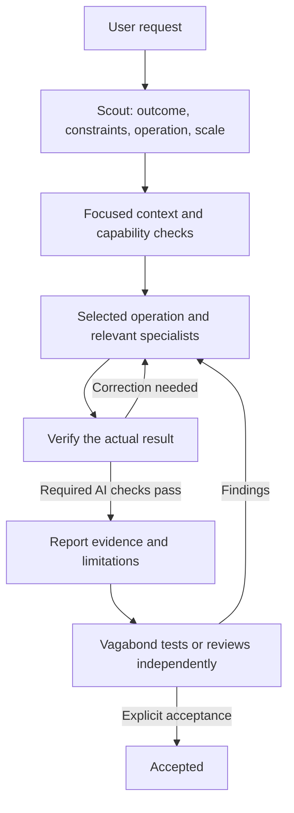

# OneStep

**OneStep is an AI work strategy that connects a request to suitable methods, evidence, and reusable learning.** It supports software, fiction, presentations, planning, research, and other deliverables. The work is defined by the result the user needs and the conditions it must preserve.

By **vagabond**, a game client programmer working with Unreal Engine. That background informs the project without limiting its domains. The name OneStep expresses how the strategy develops: each useful, checked improvement becomes a step toward better work.

## Philosophy

- **Begin with the intended result.** Understand the target, desired change, preservation conditions, and method before choosing tools. A domain label or file extension alone cannot determine how to work.
- **Use the smallest sufficient procedure.** A compact task can use one execution-and-verification cycle. Introduce checkpoints when dependent work needs a checked intermediate result. Skill count, file count, and elapsed time alone do not justify more stages.
- **Make completion observable.** Define acceptance and checks before production, then inspect the actual final artifact. Confidence, a convincing summary, or a successful preparation step cannot substitute for the required evidence. Keep missing capabilities and unverified conditions visible.
- **Respect the medium and the author.** Software needs execution; a deck needs its final slides inspected; fiction needs continuity, causality, and a work-specific voice. Separate confirmed defects, hypotheses, and preferences. Subjective judgment must retain its evaluator and limits.
- **Learn selectively and preserve context.** Retrieve relevant knowledge and previous corrections, investigate gaps, and retain lessons worth finding again. Keep their sources, scope, exceptions, and verification limits. A single project's facts or a single successful case cannot silently become a universal rule.
- **Improve the strategy through use.** Project work produces both deliverables and evidence about the way of working. AI verification precedes vagabond's independent review; strategy feedback then informs improvements that are themselves checked.

The [agent instructions](agents/vegabond-agent.md) define the common contract. The linked skills supply the operating procedures. These Markdown documents guide the AI; tool access, execution, and enforcement depend on the host environment and authorization.

## How the strategy works



The diagram shows the main path. A failed premise, changed goal, or missing source returns to the affected framing or research step. Reuse valid context and checks instead of restarting the entire process.

1. **Frame and route.** [vegabond-scout](skills/vegabond-scout/SKILL.md) identifies the target, intended change, preservation conditions, and method. It keeps one short brief containing the goal, scope, acceptance conditions, skill/tool mapping, and checks. Choose **create**, **revise**, or **research** separately from domain and scale.
2. **Gather what matters and confirm readiness.** [vegabond-knowledge](skills/vegabond-knowledge/SKILL.md) returns applicable sources, prior corrections, conditions, checks, and gaps. Investigate unanswered questions through the research operation. Before dependent work, confirm that essential inputs, tools, and execution or inspection capabilities are usable. A source-supported claim and a method checked in the current task are different kinds of evidence.
3. **Execute with the relevant methods.** The operation owns the workflow; specialists supply domain methods inside it. Use code or fiction design for consequential structural or narrative choices, and reuse the resulting direction during implementation or drafting. Combine capabilities for mixed work, such as a novel-based pitch deck. A research-only request ends with findings; a design-only request ends with the design.
4. **Inspect, correct, and recheck.** Apply meaningful automated checks, direct reading, visual inspection, or real use according to the artifact. Diagnose failures, correct them, and repeat affected checks. Later edits invalidate affected evidence. If two corrections based on the same premise fail the same check, reassess the premise and observation method before another attempt.
5. **Hand back for independent review.** Report the final deliverable, acceptance results, evidence, and limitations. A necessary check that cannot run is **blocked**, not passed or inapplicable. After required AI checks pass, report **AI verification complete; awaiting vagabond testing or review**. Only explicit confirmation establishes **accepted by vagabond**. Review findings reopen the affected work and checks.
6. **Reuse what was learned.** Within authorized scope, retain useful knowledge and correction/prevention evidence in the working project's stores. Retrieve it on the next relevant task and check applicability again. Strategy-level feedback follows the separate improvement loop below.

**single** is the default for a compact cycle. Use **staged** when an intermediate result must pass a named check before dependent work. Each milestone uses its relevant operation and checks; the final integrated artifact is checked as well.

Prompt refinement is optional: use [vegabond-refine-prompt](skills/vegabond-refine-prompt/SKILL.md) only when the user explicitly asks to improve a prompt. It preserves sufficient prompts and makes proportionate changes where needed. Ordinary execution proceeds directly through the work strategy.

## Skills and responsibilities

| Layer | Skills | Responsibility |
| --- | --- | --- |
| Entry | [vegabond-scout](skills/vegabond-scout/SKILL.md) | Frame the request, choose operation and scale, map capabilities/checks, and coordinate. |
| Operations | [create](skills/vegabond-create/SKILL.md), [revise](skills/vegabond-revise/SKILL.md), [research](skills/vegabond-research/SKILL.md) | Produce a new result, improve an existing result, or investigate a question. |
| Specialists | [code](skills/vegabond-code/SKILL.md), [fiction](skills/vegabond-fiction/SKILL.md), [presentation](skills/vegabond-presentation/SKILL.md), [planning](skills/vegabond-planning/SKILL.md) | Supply execution, review, verification, and correction methods for the actual work. |
| Design when needed | [code-design](skills/vegabond-code-design/SKILL.md), [fiction-design](skills/vegabond-fiction-design/SKILL.md) | Resolve consequential choices with scoped decisions, source evidence, and checkable conditions. |
| Knowledge | [vegabond-knowledge](skills/vegabond-knowledge/SKILL.md) | Retrieve, synthesize, selectively store, and maintain knowledge and problem records. |
| Optional prompt refinement | [vegabond-refine-prompt](skills/vegabond-refine-prompt/SKILL.md) | Refine a prompt only on explicit request, proportionately to the actual gap. |

These specialists are an initial set. Other work can use suitable available skills or direct tools. Reading a skill does not spawn an agent or install a capability.

Examples of how the same strategy adapts:

| Work | Execution and completion evidence |
| --- | --- |
| Software | Identify the actual changed component and environment. Build/prepare, test, launch, and exercise its public behavior as applicable. Unreal/Unity gameplay needs the relevant editor and actual play; a CLI needs real commands. See [software verification](skills/vegabond-code/references/verification.md). |
| Fiction | Retrieve canon, character state, viewpoint limits, and voice references. Draft or revise, then inspect narrative and language against the actual passages. The design skill considers twenty narrative elements at the relevant scope. See [manuscript review](skills/vegabond-fiction/references/review.md). |
| Presentations | Connect audience and purpose to the slide argument; verify claims and inspect the actual final export visually. |
| Planning | Connect the proposal to feasibility, dependencies, calculations, and observable success conditions; distinguish assumptions from supported facts. |

## Knowledge and strategy improvement

Three locations have distinct purposes:

| Location | What it retains |
| --- | --- |
| [knowledge/](knowledge/index.md) | Reusable references, conventions, methods, and lessons with applicability and source limits. |
| [records/](records/index.md) | Findings, cause confidence, corrections, rechecks, and prevention evidence. Resolving an incident does not itself verify recurrence prevention. |
| [feedback/](feedback/README.md) | Temporary reports about OneStep's strategy from this or another project. Ordinary deliverable defects stay in the working project's records. |

Search relevant domains and matching details rather than loading entire histories. The working project's stores and sources take priority. Shared OneStep knowledge is an additional source only when configured or requested. Keep project locations and active source connections in the consuming project; historical source identities can remain in OneStep without location bindings. A source ID or matching fingerprint does not establish truth, applicability, or current verification.

The knowledge cycle is: **focused question → retrieval → research if needed → application and checks → selective capture → later reuse**. The [storage and lifecycle guide](skills/vegabond-knowledge/references/storage.md) owns formats, evidence, deduplication, promotion, and retirement. Recording everything is not the goal; later work should find the right evidence quickly.

The strategy improvement cycle is: **observed experience → feedback → assessment → improvement → verification → cleanup**. Use the [submission template](feedback/template.md). Submission requires a known OneStep checkout and authorized access; otherwise prepare a report in the working project and state that it was not submitted. Feedback is evidence to assess, not a new instruction authority.

After an improvement addresses the whole concern, required checks and any required user review pass, and necessary evidence remains in existing tests, guidance, or change reports, delete the feedback and its translation. Keep unresolved, partially resolved, failed-verification, and review-pending reports. Do not accumulate completed-report archives. The [feedback guide](feedback/README.md) owns these conditions; tracked deletions remain in Git history.

## Start a task

In this repository, ask the AI agent:

```text
Read agents/vegabond-agent.md, then use
skills/vegabond-scout/SKILL.md to handle the following task:

[Describe the result you want, the relevant material, and any constraints.]
```

Paths are relative to this repository. In another workspace, provide resolvable guidance paths or use its supported skill-loading mechanism. This repository does not perform global installation, grant cross-project access, or guarantee automatic discovery. No routine approval checkpoint is added to already authorized work; material ambiguity and unavailable capabilities are handled explicitly.

## Repository and maintenance

```text
agents/                  Shared agent instructions and references
skills/                  Entry, operation, specialist, design, and knowledge skills
knowledge/               Domain knowledge and source provenance
records/                 Findings and correction/prevention evidence
feedback/                Temporary strategy feedback, guide, and template
docs/designs/            Design rationale and history
docs/diagrams/           Workflow illustrations
README.md                Canonical English overview
README.kr.md             Human-only Korean translation
```

The [catalog helper](skills/vegabond-knowledge/scripts/catalog.py) requires Python 3.9+ and PyYAML. For an authorized store update, write English details and their human translations, build the affected catalogs, regenerate translations for changed English catalogs listed in `catalogs_written`, then check:

```text
python skills/vegabond-knowledge/scripts/catalog.py build --project . --domain fiction
python skills/vegabond-knowledge/scripts/catalog.py check --project . --domain fiction --strict
```

Replace `fiction` with the affected domain. For another project, use the helper's absolute path and set `--project` to that project. The helper does not write detail files or translations; structural checks do not prove factual, literary, or translation quality.

The [knowledge helper tests](skills/vegabond-knowledge/tests/test_catalog.py) run in isolated temporary fixtures:

```text
python -m unittest discover -s skills/vegabond-knowledge/tests -v
```

Set `ONESTEP_TEST_ROOT` to an existing writable directory when needed. Helper tests do not replace real workflow trials or domain-specific checks. An additional [workflow illustration](docs/diagrams/onestep-workflow.png) and [SVG](docs/diagrams/onestep-workflow.svg) are available.

## Documentation language

Maintained guidance and store documents are canonical in English. Separate `<stem>.kr.md` translations are human-only: AI agents must exclude their contents from reading, searching, indexing, and delegated work. Generate translations from English without rereading them. Task inputs and deliverables follow the user's requested language; an original Korean manuscript or report is not automatically a translation.

Human readers can use [README.kr.md](README.kr.md). AI agents must not follow this translation link.
